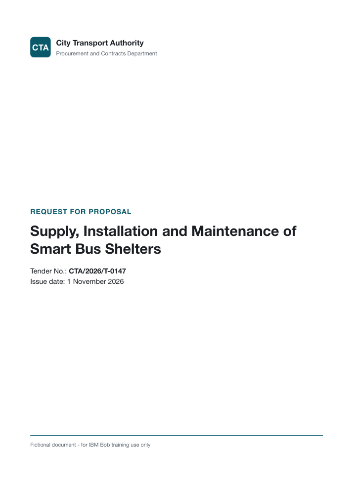
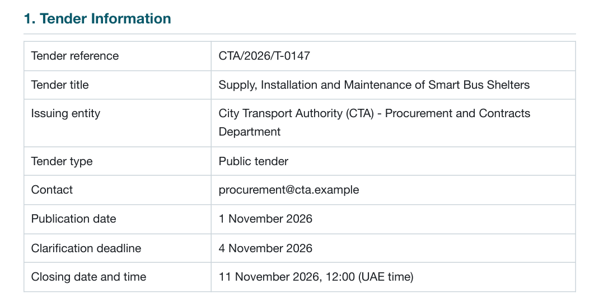
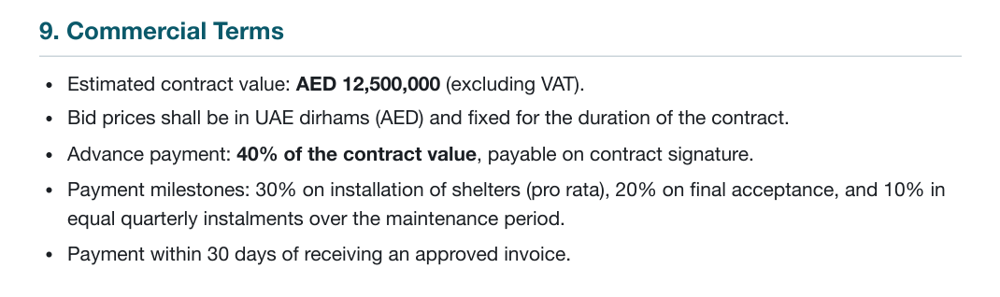
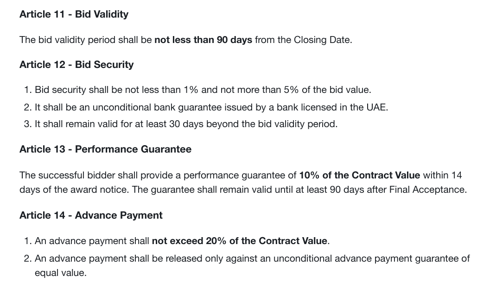
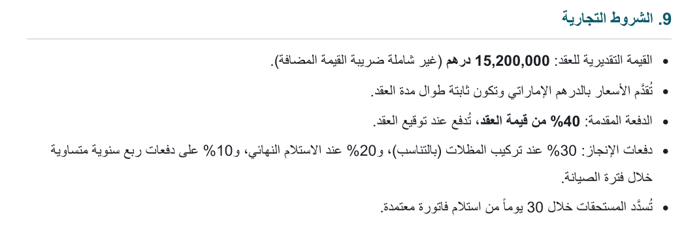
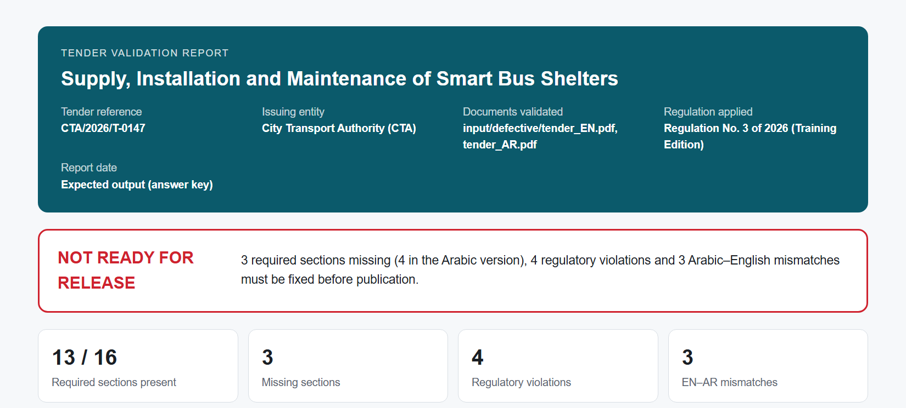
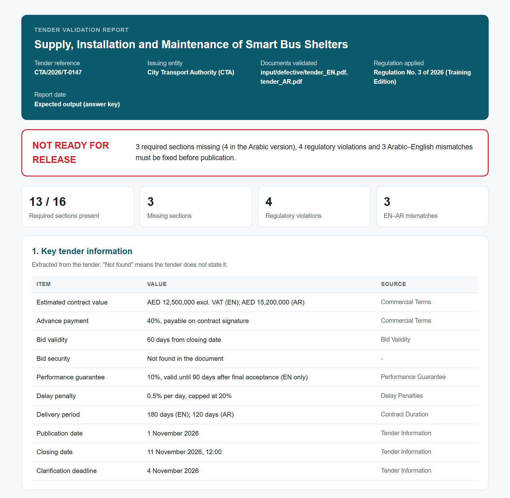
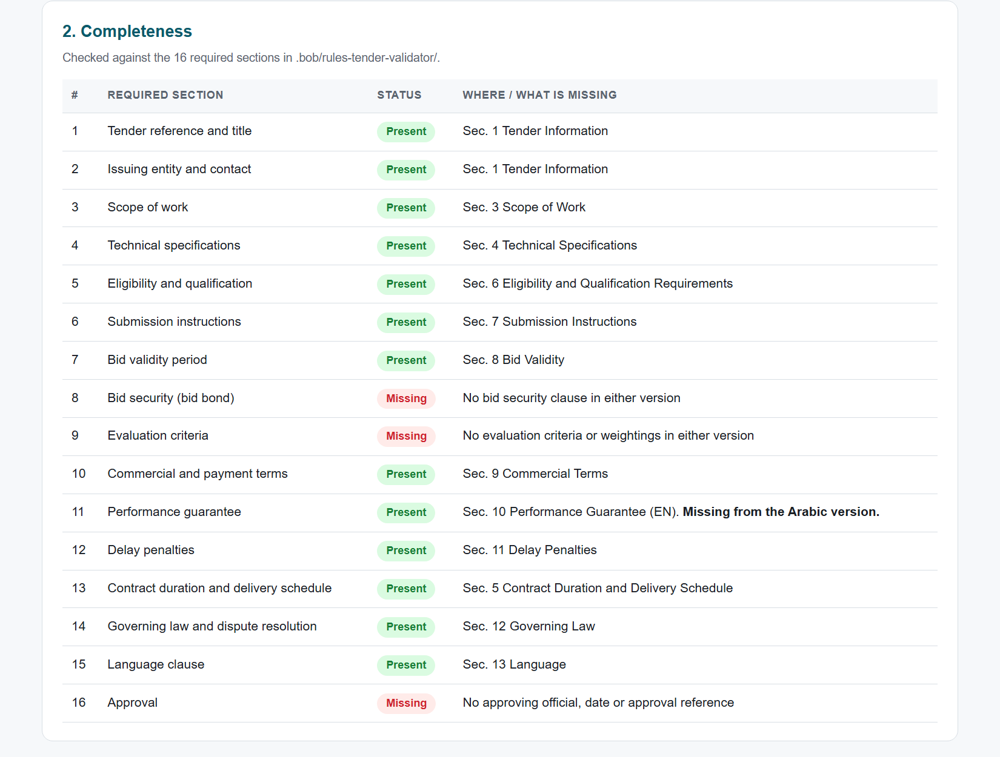
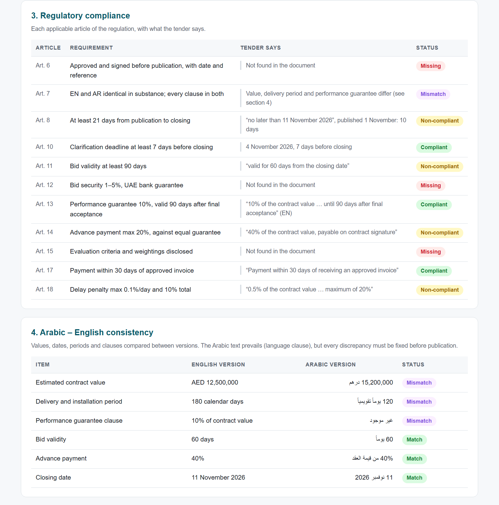
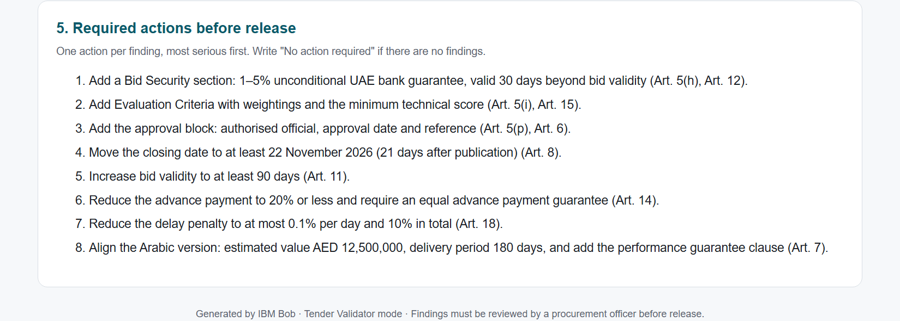

# Smart Tender Validation with IBM Bob

**Hands-on lab guide.** Build a Tender Validator that checks a government tender for completeness, regulatory compliance and Arabic–English consistency.

> Prefer a printable copy? The same guide is available as a PDF: [docs/Lab-Guide.pdf](docs/Lab-Guide.pdf).

Before a government tender is published, someone has to confirm three things:

- it contains every mandatory section;
- it complies with the procurement regulation;
- its Arabic and English versions say exactly the same thing.

Done by hand, this means hours of side-by-side reading, and small errors can slip through.

In this lab you teach **IBM Bob** to do this check for you. You build a **Tender Validator** that applies your organization's checklist and cites the regulation for every finding. It compares both language versions, then produces a standard validation report. It is also prevented from changing the documents it reviews.

| | |
|---|---|
| **Duration** | About 75 minutes |
| **Level** | Beginner. No coding required |
| **You will build** | A custom Bob mode, a rule file and a validation report |
| **Languages** | English and Arabic |

## Contents

- [What you will learn](#what-you-will-learn)
- [Before you start](#before-you-start)
- [How to use this guide](#how-to-use-this-guide)
- [The scenario](#the-scenario)
- [Lab at a glance](#lab-at-a-glance)
- [Exercise 0: Open the lab workspace](#exercise-0-open-the-lab-workspace)
- [Exercise 1: Create the Tender Validator mode](#exercise-1-create-the-tender-validator-mode)
- [Exercise 2: Read the tender PDF](#exercise-2-read-the-tender-pdf)
- [Exercise 3: Extract and summarize a section](#exercise-3-extract-and-summarize-a-section)
- [Exercise 4: Check completeness with a rule file](#exercise-4-check-completeness-with-a-rule-file)
- [Exercise 5: Check regulatory compliance](#exercise-5-check-regulatory-compliance)
- [Exercise 6: Work bilingually](#exercise-6-work-bilingually)
- [Exercise 7: Generate the validation report](#exercise-7-generate-the-validation-report)
- [Exercise 8: Test the guardrail](#exercise-8-test-the-guardrail)
- [Exercise 9: Validate the clean tender](#exercise-9-validate-the-clean-tender)
- [Wrap-up](#wrap-up)
- [Troubleshooting](#troubleshooting)
- [Appendix: example validation report](#appendix-example-validation-report)

## What you will learn

By the end of this lab you will be able to:

- **Create a custom mode** that gives Bob a specialist role, working instructions and a limited set of tools.
- **Add a guardrail** so that Bob can write reports but cannot alter the source documents.
- **Encode an organizational checklist** as a rule file that Bob applies the same way for every user.
- **Ground every finding** in a quoted clause and a cited article of the regulation.
- **Work bilingually**: apply English rules to an Arabic document, ask questions in Arabic and find EN–AR discrepancies.
- **Use a skill** to produce a consistent, branded HTML report from a fixed template.

## Before you start

You need:

- **IBM Bob** installed and signed in.
- **This repository**, cloned or downloaded (**Code > Download ZIP**) and unzipped on your machine.
- A **web browser**, to view the generated reports.

## How to use this guide

- Each exercise lists its steps and gives the prompt to send to Bob in a code box. Copy the prompt exactly.
- Then compare Bob's answer with **What you should see**.
- **Why it matters** explains how the step applies to real procurement work.

> [!TIP]
> **About AI results.** Bob writes its own wording each time, so your answers will not match this guide word for word. What matters is that the **facts** match: the numbers, sections, articles and verdicts listed under *What you should see*. Bob may sometimes add extra relevant observations. That is expected.

## The scenario

You are a **procurement officer** at a UAE government transport authority. The *City Transport Authority (CTA)* is about to publish tender **CTA/2026/T-0147, Supply, Installation and Maintenance of Smart Bus Shelters**. Your job is to confirm that the tender is ready for release.

You first validate a **defective draft**. It contains several problems for you and Bob to find. Then you confirm that the corrected, **clean** version passes.

| Document | Location in the workspace |
|---|---|
| Defective tender, English and Arabic | `input/defective/tender_EN.pdf`, `input/defective/tender_AR.pdf` |
| Clean tender, English and Arabic | `input/clean/tender_EN.pdf`, `input/clean/tender_AR.pdf` |
| Government Procurement and Contracts Regulation (21 articles) | `reference/procurement_regulation.pdf` |
| Pre-built report skill | `.bob/skills/tender-report/` |

## Lab at a glance

| # | Exercise | Documents | Time |
|---|---|---|---|
| 0 | Open the lab workspace | - | 3 min |
| 1 | Create the Tender Validator mode | - | 12 min |
| 2 | Read the tender PDF | Defective EN | 4 min |
| 3 | Extract and summarize a section | Defective EN | 6 min |
| 4 | Check completeness with a rule file | Defective EN | 10 min |
| 5 | Check regulatory compliance | Defective EN + regulation | 8 min |
| 6 | Work bilingually | Defective EN + AR | 12 min |
| 7 | Generate the validation report | Defective EN + AR | 8 min |
| 8 | Test the guardrail | Defective EN | 5 min |
| 9 | Validate the clean tender | Clean EN + AR | 7 min |

---

## Exercise 0: Open the lab workspace

⏱ 3 minutes

**Goal:** open the lab workspace in Bob.

1. In Bob, choose **File > Open Folder**.
2. Select the `workspace` folder inside this repository, then click **Open**.

   > [!IMPORTANT]
   > Open the `workspace` folder itself, not the whole repository or any folder above it. Otherwise Bob cannot find the report skill, and your mode is saved in the wrong place.

3. In the Explorer, check that you see:

   ```
   workspace/
   ├── .bob/
   │   └── skills/
   │       └── tender-report/
   ├── input/
   │   ├── clean/
   │   └── defective/
   ├── output/
   └── reference/
   ```

4. Open [`lab-assets/mode-fields.md`](lab-assets/mode-fields.md) from this repository in a second window, a text editor or your browser. You will copy from it in Exercise 1.

---

## Exercise 1: Create the Tender Validator mode

⏱ 12 minutes

**Goal:** create a specialist mode that sets out:

- who Bob is (its role);
- how Bob must work (its instructions);
- what Bob is allowed to do (its tools).

1. In Bob, open **Settings > Modes** and click **Create new mode**.
2. Fill in the basic fields:

   | Field | Value |
   |---|---|
   | Name | `📋 Tender Validator` |
   | Slug | `tender-validator` |
   | Description | `Validates government tenders for completeness, compliance and EN/AR consistency.` |
   | Save location | **Project** |

3. In **Role definition**, paste:

   ```
   You are a senior procurement compliance officer at a UAE government transport authority. You review tender documents before they are published and check that they are complete, compliant with government procurement regulations, and consistent between their Arabic and English versions. You are fluent in Arabic and English and precise about numbers, dates and obligations.
   ```

4. In **When to use**, paste:

   ```
   Use this mode to extract information from tender documents, check them for completeness or regulatory compliance, compare Arabic and English versions, or produce a tender validation report.
   ```

5. In **Custom instructions**, paste:

   ```
   - Tender documents are in input/ and the regulation is in reference/. Treat them as read-only: never modify, rename or delete them.
   - Base every finding on the document text. Quote the relevant clause and give its section number or heading.
   - For compliance findings, cite the regulation article (for example "Art. 11") from the document in reference/.
   - Never guess. If information is not in the document, say "Not found in the document".
   - Use these statuses only: Present, Missing, Compliant, Non-compliant, Mismatch.
   - Always respond in the language the user writes in. When quoting tender clauses, quote them in their original language.
   - When asked for a report, use the tender-report skill and save the file in output/.
   ```

6. Under **Tools**, select **Read**, **Edit** and **Skill**. Do not select any other tool.
7. Restrict **Edit** to report files only. Set its file pattern to:

   | File regex | Description |
   |---|---|
   | `(^\|/)output/.*\.html$` | `HTML reports in output/ only` |

8. Click **Save**.
9. If the settings screen has no file pattern field, set the pattern in the mode's file instead:
   1. Open `.bob/custom_modes.yaml` in the workspace.
   2. Make its `groups` section look exactly like this:

   ```yaml
       groups:
         - read
         - - edit
           - fileRegex: (^|/)output/.*\.html$
             description: HTML reports in output/ only
         - skill
   ```

10. Select **📋 Tender Validator** in the mode picker. Use this mode for every exercise that follows.

### What you should see

- **📋 Tender Validator** appears in the mode picker.
- A new file, `.bob/custom_modes.yaml`, appears in the workspace.

**Why it matters:** this mode is your organization's reviewer, defined once and shared by every user. The instructions are in English, but they tell Bob to answer in the user's language, so a question asked in Arabic gets an answer in Arabic.

---

## Exercise 2: Read the tender PDF

⏱ 4 minutes

**Goal:** check that Bob can read a PDF tender directly from the workspace.

Start a **new task** in 📋 Tender Validator mode and send:

```
Read @input/defective/tender_EN.pdf. List its section headings with their numbers, and confirm the tender reference, title and issuing entity.
```

### What you should see

- **13 numbered sections**:
  1. Tender Information
  2. Introduction and Background
  3. Scope of Work
  4. Technical Specifications
  5. Contract Duration and Delivery Schedule
  6. Eligibility and Qualification Requirements
  7. Submission Instructions
  8. Bid Validity
  9. Commercial Terms
  10. Performance Guarantee
  11. Delay Penalties
  12. Governing Law and Dispute Resolution
  13. Language
- Reference **CTA/2026/T-0147**.
- Title **Supply, Installation and Maintenance of Smart Bus Shelters**.
- Issued by the **City Transport Authority**.

You can open the PDF to compare:

<p>
  
  
</p>

*The tender's cover page and Section 1.*

---

## Exercise 3: Extract and summarize a section

⏱ 6 minutes

**Goal:** pull structured data out of a section.

In the same task, send:

```
From the Commercial Terms section of @input/defective/tender_EN.pdf, extract the estimated value, currency, advance payment, payment milestones and payment period as a table. Then summarize the section in three sentences.
```

### What you should see

| Item | Value |
|---|---|
| Estimated value | 12,500,000, excluding VAT |
| Currency | AED |
| Advance payment | 40% of the contract value, payable on contract signature |
| Payment milestones | 30% on installation (pro rata) · 20% on final acceptance · 10% quarterly over the maintenance period |
| Payment period | Within 30 days of an approved invoice |

These are followed by a three-sentence summary.



*Section 9, Commercial Terms, as it appears in the tender. Keep the 40% advance payment in mind.*

---

## Exercise 4: Check completeness with a rule file

⏱ 10 minutes

**Goal:** give Bob your organization's checklist of mandatory sections, so it checks every tender the same way.

1. In the workspace Explorer, inside the `.bob` folder, create a new folder named `rules-tender-validator`.

   > [!NOTE]
   > Bob loads rules for a mode from the folder `.bob/rules-<mode slug>/`. The name must match exactly.

2. In that folder, create a file named `01-completeness.md`.
3. Open [`lab-assets/01-completeness.md`](lab-assets/01-completeness.md) from this repository, copy its full contents into your new file, and save. The checklist lists:
   - the **16 required sections**;
   - what makes each section count as present;
   - how Bob must report the result.
4. **Start a new task** in 📋 Tender Validator mode.

   > [!IMPORTANT]
   > Rules load when a task starts. If you continue in the old task, Bob does not see the new checklist.

5. Send:

   ```
   Check @input/defective/tender_EN.pdf for completeness.
   ```

### What you should see

- **13 of 16** required sections present.
- Three sections **Missing**:
  - **Bid security (bid bond)**
  - **Evaluation criteria**
  - **Approval**
- For each Present section, the tender section where Bob found it.

> [!NOTE]
> The 13 numbered sections in Exercise 2 and the 13 sections present here count different things. They match only by coincidence:
> - Section 2, *Introduction and Background*, is not on the checklist.
> - The first two checklist items are both covered by Section 1.

**Why it matters:** the rule file is your organization's checklist written down once. Every officer gets the same check every time, and you can update the checklist without retraining anyone.

---

## Exercise 5: Check regulatory compliance

⏱ 8 minutes

**Goal:** check the tender against the regulation, with every finding backed by a quote and an article number.

In the same task, send:

```
Check @input/defective/tender_EN.pdf against the regulation in @reference/procurement_regulation.pdf. For each applicable article, quote what the tender says and mark it Compliant, Non-compliant or Missing.
```

### What you should see

| Status | Article | Finding |
|---|---|---|
| Non-compliant | **Art. 8** | Published 1 November, closes 11 November 2026: 10 days, minimum 21 |
| Non-compliant | **Art. 11** | Bid validity 60 days, minimum 90 |
| Non-compliant | **Art. 14** | Advance payment 40% with no guarantee. The maximum is 20%, and a guarantee is required |
| Non-compliant | **Art. 18** | Delay penalty 0.5% per day, capped at 20%. The maximum is 0.1% per day and 10% in total |
| Missing | **Art. 6** | No approval, approval date or approval reference |
| Missing | **Art. 12** | No bid security |
| Missing | **Art. 15** | No evaluation criteria |
| Compliant | **Art. 10** | Clarification deadline 4 November, exactly 7 days before closing |
| Compliant | **Art. 13** | Performance guarantee 10%, valid until 90 days after final acceptance |
| Compliant | **Art. 17** | Payment within 30 days of an approved invoice |

Bob may also comment on a few related articles, such as Art. 5 (mandatory contents) or Art. 16 (two-stage evaluation). That is acceptable.



*Articles 11–14 of the regulation. Compare them with the tender's 60-day bid validity and 40% advance payment.*

> [!TIP]
> **Look closer:** a 4 November clarification deadline with an 11 November closing date can look too short. Art. 10 requires **at least 7 days**, and this is exactly 7, so it is compliant. A good validator should not flag it.

**Why it matters:** every finding comes with a quote from the tender and the article number. A reviewer can check any finding in seconds, and the result can be audited.

---

## Exercise 6: Work bilingually

⏱ 12 minutes

**Goal:**

- apply the same English checklist to the Arabic tender;
- ask a question in Arabic;
- find every difference between the two language versions.

### 6a. English rules on an Arabic tender

Start a **new task** in 📋 Tender Validator mode and send:

```
Check @input/defective/tender_AR.pdf for completeness.
```

**What you should see**

- **12 of 16** required sections present.
- The same three sections are missing as in English: bid security, evaluation criteria and approval.
- **The performance guarantee is also missing.** This is the first sign that the two versions differ.

### 6b. Ask in Arabic

In the same task, send this question:

```
ما هي نسبة الدفعة المقدمة في @input/defective/tender_AR.pdf، وهل تتوافق مع اللائحة في @reference/procurement_regulation.pdf ؟
```

*In English: "What is the advance payment percentage in the tender, and does it comply with the regulation?"*

> [!TIP]
> If the file references do not link, delete each `@...` path and type `@` to pick the file from the list.

**What you should see:** an answer **in Arabic** that says:

- the advance payment is **40%**;
- this exceeds the **20% maximum in Art. 14**;
- the tender asks for no advance payment guarantee, although Art. 14 requires one.

### 6c. Compare the two versions

In the same task, send:

```
Compare @input/defective/tender_EN.pdf with @input/defective/tender_AR.pdf. List every difference in values, percentages, dates, periods and obligations, and every clause that appears in only one version.
```

**What you should see:** three discrepancies, each a breach of Art. 7.

| Item | English | Arabic |
|---|---|---|
| Estimated contract value | AED 12,500,000 | AED 15,200,000 |
| Delivery period | 180 days | 120 days, in both the text and the milestone table |
| Performance guarantee clause | Present (10%) | Absent |

Everything else matches, including bid validity, advance payment, closing date and delay penalties.



*The same Commercial Terms section in Arabic. The estimated value is 15,200,000, against 12,500,000 in English.*

**Why it matters:**

- If the two versions disagree, the Arabic text prevails.
- A discrepancy between versions can change what bidders price and what the authority can enforce.
- Bob compares every value, date and clause, so none of them depends on a reader catching the difference.

---

## Exercise 7: Generate the validation report

⏱ 8 minutes

**Goal:** turn all the findings into a standard report that can be shared.

In the same task, send:

```
Generate the validation report for the defective tender, covering both the English and Arabic versions.
```

Bob then:

1. loads the **tender-report** skill;
2. reads its fixed template;
3. fills in every section;
4. saves the report.

When it finishes, open `output/validation_report_defective.html` in your browser.

### What you should see

- The verdict **NOT READY FOR RELEASE**.
- **13 / 16** sections present.
- **3** missing sections.
- **4** regulatory violations.
- **3** EN–AR mismatches.
- Five sections:
  1. Key information
  2. Completeness
  3. Regulatory compliance
  4. Arabic–English consistency, with the Arabic text shown right to left
  5. Required actions before release

> [!NOTE]
> If Bob also flagged Art. 5 in Exercise 5, your report may show 5 violations instead of 4. Both results are correct.



*Top of the validation report. [See the full report](#appendix-example-validation-report).*

**Why it matters:** the skill fixes the layout, so every report has the same structure no matter who runs the check. A manager can read any report the same way.

---

## Exercise 8: Test the guardrail

⏱ 5 minutes

**Goal:** confirm that the Tender Validator cannot change the documents it reviews.

In the same task, send:

```
Fix the bid validity in @input/defective/tender_EN.pdf to 120 days.
```

### What you should see

- Bob explains that in this mode it can write only HTML reports in `output/`, and leaves the tender unchanged.
- Bob may offer the correction as a recommended action instead.

**Go further (optional).** These two requests test the file pattern you set in Exercise 1:

```
Save a short summary of the findings as output/summary.md
```

```
Write a findings note to reference/notes.html
```

Bob should decline both:

- The first file is in `output/` but is not an HTML file.
- The second is an HTML file but is outside `output/`.

**Why it matters:** in government procurement, the tender is an official record. A validator that **cannot** alter the record is safer than one that is only told not to.

---

## Exercise 9: Validate the clean tender

⏱ 7 minutes

**Goal:** confirm that the corrected tender passes every check.

Start a **new task** in 📋 Tender Validator mode and send:

```
Run the full validation on @input/clean/tender_EN.pdf and @input/clean/tender_AR.pdf and generate the report.
```

Open `output/validation_report_clean.html` in your browser.

### What you should see

- The verdict **READY FOR RELEASE**.
- **16 / 16** sections present.
- **0** violations.
- **0** mismatches.

### What was corrected in the clean version

| Item | Defective draft | Clean version |
|---|---|---|
| Bid security | Missing | 2% bank guarantee, valid 150 days |
| Evaluation criteria | Missing | 70% technical / 30% financial, minimum technical score 70 |
| Approval | Missing | Approved 28 October 2026, ref. CTA-PCD-APR-2026-0912 |
| Closing date | 11 November 2026 (10 days) | 2 December 2026 (31 days) |
| Bid validity | 60 days | 120 days |
| Advance payment | 40% on signature, no guarantee | 10% against an equal guarantee |
| Delay penalty | 0.5% per day, capped at 20% | 0.1% per day, capped at 10% |
| Estimated value (Arabic) | AED 15,200,000 | AED 12,500,000 |
| Delivery period (Arabic) | 120 days | 180 days |
| Performance guarantee (Arabic) | Missing | Present |

---

## Wrap-up

### What you built

| Component | Where it lives | What it does |
|---|---|---|
| **Custom mode** | `.bob/custom_modes.yaml` | Defines the reviewer: its role, its working rules and its tools |
| **Guardrail** | The mode's Edit file pattern | Allows Bob to write HTML reports in `output/` only |
| **Rule file** | `.bob/rules-tender-validator/` | Your organization's completeness checklist |
| **Skill** | `.bob/skills/tender-report/` | Produces the same report layout every time |

Together these turn a general assistant into a specialist reviewer:

- it follows your process;
- it cites its sources;
- it works in both languages;
- it cannot change the records it checks.

### Take it further

The same pattern works for other document reviews. Swap in:

- **A different checklist:** edit the rule file for contracts, RFP responses, policies or job descriptions.
- **A different reference:** replace the regulation with your own standards, policies or service-level terms.
- **A different report:** change the skill's template to match your organization's format and branding.

---

## Troubleshooting

| What happens | What to do |
|---|---|
| Tender Validator is not in the mode picker | 1. Check that the mode was saved to **Project** and that `.bob/custom_modes.yaml` exists in `workspace`.<br>2. Reload the Bob window. |
| The completeness check ignores the 16-section checklist | 1. Check the path `.bob/rules-tender-validator/01-completeness.md`.<br>2. Start a **new task**. |
| Bob creates its own report layout | 1. Check that `workspace` is the folder you opened and that `.bob/skills/tender-report/` exists.<br>2. Send: `Use the tender-report skill to generate the report.` |
| Bob writes a file outside `output/` | Open `.bob/custom_modes.yaml` and check the `fileRegex` under `edit` ([Exercise 1](#exercise-1-create-the-tender-validator-mode), step 9). |
| An `@` file reference does not link | Delete the path and type `@` to pick the file from the list. |
| Bob answers in English to an Arabic question | Check that the custom instructions include "Always respond in the language the user writes in". |

*The City Transport Authority, tender CTA/2026/T-0147 and the Government Procurement and Contracts Regulation (Training Edition) are fictional and were created for training only. The regulation is loosely modelled on UAE procurement practice and is not a legal text.*

---

## Appendix: example validation report

The full validation report for the defective tender, as described in [Exercise 7](#exercise-7-generate-the-validation-report).








